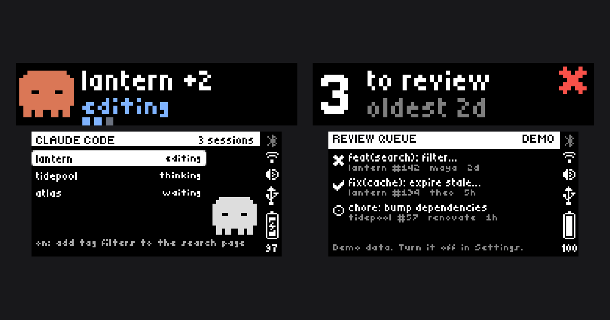
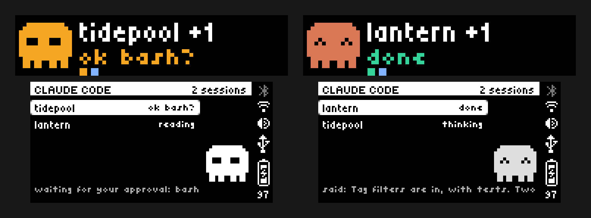
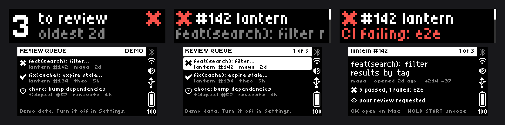
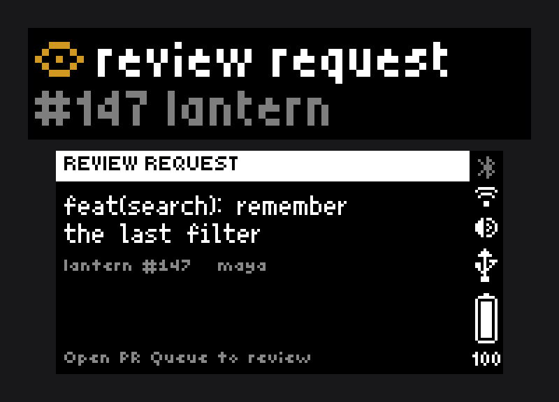

# busybar

Things I run on my [BUSY Bar](https://busy.app): a widget that shows what Claude Code is doing, an on-device app for my GitHub pull requests, and a Spotify now-playing widget.



Every image in this repo is demo data: invented repos, people, titles and sessions.

This is a personal project, built for one desk. It is not affiliated with BUSY, Flipper Devices, Anthropic or GitHub. It works on firmware 1.3.1; the bar updates itself, and an update has already broken it once.

## What's here

| | Where | What it is |
|---|---|---|
| **Claude Code widget** | `src/widgets/claude`, `hooks/` | A Mac daemon that draws your Claude Code sessions: which project, what it is doing, and whether one is waiting on you. |
| **PR Queue** | `apps/pr-queue`, `src/widgets/pr-queue-relay` | A JS app that runs on the bar (review requests and your own PRs' CI, on the knob), plus the Mac relay that feeds it. |
| **Spotify widget** | `src/widgets/spotify` | Artist, title and artwork from the Spotify desktop app. |
| **`.anim` encoder** | `src/lib/anim.ts` | Writes the bar's animation format, version 1 (`bicycle1`). |

## You need

- A BUSY Bar on firmware 1.3.1 or later, plugged into a Mac over USB. Over USB the bar is a small network at `10.0.4.20` with an HTTP API and no password.
- macOS. The daemons are launchd agents, and the relay uses `open` and the GitHub CLI's Keychain login.
- Node 22 for the widgets and the relay. Node 24 to build the app (`busy-cli` needs it).
- [`jq`](https://jqlang.org) for the Claude Code hook, and [`gh`](https://cli.github.com), logged in, for PR Queue.

```sh
git clone https://github.com/josheche/busybar ~/busybar   # the launchd agents expect ~/busybar
cd ~/busybar && npm install
npm run smoke        # checks the bar is reachable and draws a test line
npm run screenshot   # reads both screens back as PNGs, into /tmp/busybar-shots
```

## Claude Code widget



Claude Code [hooks](https://code.claude.com/docs/en/hooks) run `hooks/claude-code-hook.sh`, which writes one small JSON file per session under `~/.busybar/claude/sessions/`. The daemon watches that folder, picks the most urgent session for the front screen and lists them all on the back. When a session needs you, the mascot turns amber and the status LED blinks. After ten idle minutes it clears itself.

```sh
npm run claude:hooks           # adds the hook to ~/.claude/settings.json (backs it up first)
npm run claude                 # run in the foreground
./scripts/install.sh claude    # or install it as a launchd agent; --remove claude to stop
```

`npm run claude:hooks -- --uninstall` takes the hooks out again.

## PR Queue



Two lists: pull requests waiting on your review, and your own with their CI.

| Control | Does |
|---|---|
| Knob | Move through the list. The glance sits above the first PR. |
| OK | Open the detail. In the detail, open that PR in the Mac's browser. |
| Hold OK | Sync now. |
| START | Switch lists. |
| Hold START | On a PR: snooze it until it changes. On the glance: bring that list's snoozed PRs back. |
| BACK | Close the detail, then quit. |

The app holds no GitHub credential. A relay on the Mac runs the queries through `gh` and serves the finished lists to the bar over the USB cable.

```sh
gh auth status                          # the relay uses this login
./scripts/install.sh pr-queue-relay     # or: npm run pr-queue-relay

cd apps/pr-queue
nvm install && npm install    # Node 24, from .nvmrc
npm run build && npm run app:install && npm run app:run
```

Turn on **Show demo data** in the app's settings (in the bar's web page) to try it without the relay.

The relay reads a few environment variables; set them in `launchd/app.busybar.pr-queue-relay.plist` before installing:

| Variable | Default | |
|---|---|---|
| `PR_QUEUE_DAYS` | `30` | Only PRs touched this recently. `0` turns the window off. |
| `PR_QUEUE_ORGS` | all | Space-separated owners to limit the search to. |
| `PR_QUEUE_NUDGE` | on | `0` stops the banner the relay draws when a review request arrives while the app is closed. |



## Before you copy this

The bar's USB API has no password. Anything running on the Mac, and anyone who plugs into the bar, can draw on it, read its screens back, and read its files. That shapes everything here, and it should shape what you build:

- **Never put a token in a JS app's settings.** The settings form has a "sensitive" flag, but it only masks the field in the web page. On the bar the settings are a plain file, and the same API will hand it over. That is why PR Queue's GitHub side runs on the Mac.
- **The relay serves your PR titles to the bar.** It listens only on the Mac's end of the USB link (`10.0.4.21`), answers only the bar and the Mac itself, and rejects requests not addressed to that IP. It can open a pull request page in your browser when the bar asks; it opens nothing else, and nothing it accepts can change anything on GitHub.
- **The Claude widget puts your prompts on a screen.** The hook stores each session's latest prompt and Claude's last reply as plain files under `~/.busybar/`, and the widget scrolls them on the bar's back screen. If you work on things other people in the room should not read, think about that.
- **Screenshots show whatever is on the bar.** If you publish captures, take them from demo data. `scripts/pr-queue-blog-shots.sh` and `scripts/claude-blog-shots.ts` exist because I got that wrong once.

## For agents

`AGENTS.md` holds what cannot be learned from the code: how the displays and draw priorities really behave, firmware quirks found on the hardware, and where the docs, the device's own API spec and the firmware source are. `apps/pr-queue/AGENTS.md` covers the on-device JavaScript runtime.

## License and credits

GPL-2.0-or-later, see `LICENSE`. `src/lib/anim.ts` is a port of the reference encoder in the [BUSY Bar firmware](https://github.com/busy-app/busybar-firmware) (`assets/frontend/util/seq2anim.ts`, © Flipper FZCO, GPL-2.0-or-later), which is why this repo carries the same license.

Clawd is Anthropic's Claude Code mascot. The sprite here is my own pixel drawing of it, fan art, and not something this license can grant rights to.
